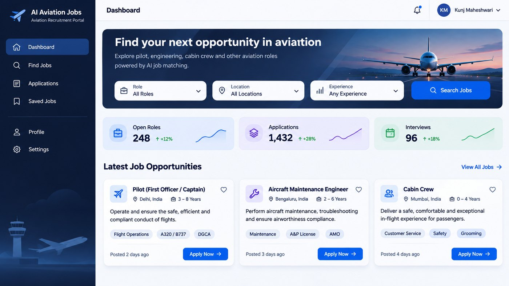
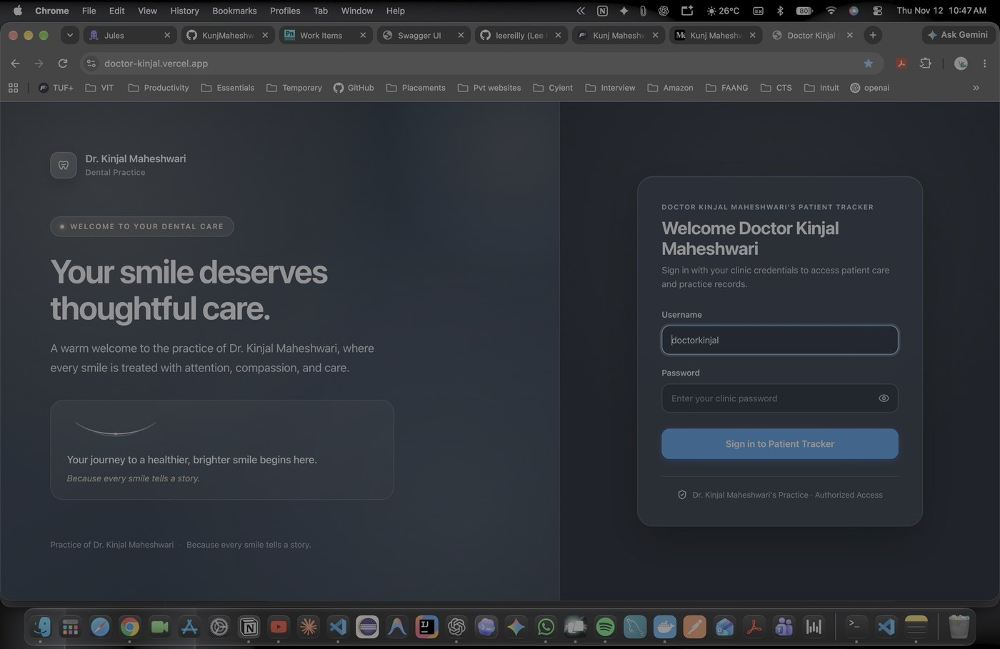

## 👋🏻 Hey, I'm Kunj

I'm a software engineer interested in building reliable backend systems, AI-powered applications, and developer tools.

I enjoy working across the engineering lifecycle understanding a problem, designing the system, implementing the solution, and verifying that it behaves reliably in real-world conditions. My experience across software development and quality engineering has shaped how I approach engineering: **maintainability, testability, and sound system design matter from day one.**

Currently focused on **Backend Engineering, Java, Spring Boot, AI Engineering, and System Design**.

---

## 🚀 Featured projects

<table border="1" cellpadding="10" cellspacing="0">
  <tr>
    <td width="50%" valign="top">
      
       
      <b>AI Engineering · Agentic Applications</b>
      <h3><a href="https://github.com/KunjMaheshwari/spring-ai-website-builder-agent">Spring AI Website Builder Agent</a></h3>
      
An AI agent that uses LLM tool calling and integrated utilities to generate websites and execute tasks.

      Java · Spring Boot · Spring AI · OpenRouter
        
      <a href="https://github.com/KunjMaheshwari/spring-ai-website-builder-agent">Source Code ↗</a>
    </td>
    <td width="50%" valign="top">
      
       
      <b>AI Engineering · Semantic Search</b>
      <h3><a href="https://github.com/KunjMaheshwari/Netflix-Movie-Recommendation-System-with-Vector-Embeddings">Netflix Movie Recommendation System</a></h3>
      
A semantic movie discovery application that uses vector embeddings to find movies by meaning and context.

      Java · Spring Boot · Spring AI · Vector Embeddings
        
      <a href="https://github.com/KunjMaheshwari/Netflix-Movie-Recommendation-System-with-Vector-Embeddings">Source Code ↗</a>
    </td>
  </tr>
  <tr>
    <td width="50%" valign="top">
      
       
      <b>Test Engineering · End-to-End Automation</b>
      <h3><a href="https://github.com/KunjMaheshwari/AI-Aviation-Jobs">AI Aviation Jobs</a></h3>
      
A browser and API automation project for an aviation recruitment portal, covering candidate and employer journeys, authentication, job workflows, negative cases, and responsive behavior.

      Playwright · JavaScript · Node.js · Express · SQLite
        
      <a href="https://github.com/KunjMaheshwari/AI-Aviation-Jobs">Source Code ↗</a>
    </td>
    <td width="50%" valign="top">
      
       
      <b>Full-Stack · Practice Management</b>
      <h3><a href="https://github.com/KunjMaheshwari/ToothSync">ToothSync</a></h3>
      
A local-first dental practice management platform for patient records, appointments, clinical workflows, prescriptions, and billing.

      Next.js · React · TypeScript · Prisma · SQLite · Google Sheets API
        
      <a href="https://doctor-kinjal.vercel.app/">Live Application ↗</a> ·
      <a href="https://github.com/KunjMaheshwari/ToothSync">Source Code ↗</a>
    </td>
  </tr>
  <tr>
    <td width="50%" valign="top">
      
       
      <b>Agentic AI · Automation Platform · In Development</b>
      <h3><a href="https://github.com/KunjMaheshwari/LogicK">LogicK</a></h3>
      
An AI-powered automation platform exploring agentic task execution, tool integrations, and isolated code execution.

      Next.js · React · PostgreSQL · Prisma · Inngest · Clerk · E2B
        
      <a href="https://github.com/KunjMaheshwari/LogicK">Source Code ↗</a>
    </td>
    <td width="50%" valign="top">
      <h3>🌍 Open Source Contributions</h3>
      
Contributing to developer tools and community projects through focused code changes and collaboration.

      <ul>
        <li>
          <a href="https://github.com/Nano-Collective/nanocoder"><b>NanoCoder</b></a> 
          PR #1985 — Support million-token context limit suffixes · <a href="https://github.com/Nano-Collective/nanocoder/pull/1985">View contribution ↗</a>
        </li>
        <li>
          <a href="https://github.com/OPCODE-Open-Spring-Fest/MailMERN"><b>MailMERN</b></a> 
          Open-source project contribution · <a href="https://github.com/OPCODE-Open-Spring-Fest/MailMERN/commits?author=KunjMaheshwari">View contributions ↗</a>
        </li>
      </ul>
      Code · Collaboration · Community
    </td>
  </tr>
</table>

---

## 🧩 Coding profiles & community

<table border="1" cellpadding="10" cellspacing="0">
  <tr>
    <td width="50%" align="center">
      
       DSA practice and problem-solving
    </td>
    <td width="50%" align="center">
      
       Algorithms and data structures
    </td>
  </tr>
  <tr>
    <td width="50%" align="center">
      
       Open-source participation
    </td>
    <td width="50%" align="center">
      
       Engineering notes and technical articles
    </td>
  </tr>
</table>

---

## 🛠️ Technologies & tools

### Languages
Java · JavaScript · TypeScript · SQL

### Backend & frameworks
Spring Boot · Node.js · Express.js · REST APIs · Next.js · React

### Databases & infrastructure
PostgreSQL · MySQL · MongoDB · SQLite · Prisma · Docker · GitHub Actions · Jenkins

### AI & emerging technologies
Spring AI · LLM Integrations · OpenRouter · Vector Embeddings · AI Agents · Tool Calling · Agentic Workflows

### Automation & testing
Playwright · Selenium WebDriver · REST Assured · TestNG · Cucumber · API Testing · End-to-End Testing

---

## 🧪 Engineering experience

My experience in enterprise quality engineering has given me practical exposure to complex applications, integrations, automation frameworks, and end-to-end workflows.

I've worked with enterprise platforms including Oracle EPM, Workday, and Veeva, using technologies such as Java, Selenium, Playwright, TestNG, and API testing.

I enjoy solving recurring problems at the right abstraction layer — improving the framework or underlying system instead of repeatedly patching individual tests.

**Build it well. Make it reliable. Test it continuously.**

---

## 📊 GitHub & coding activity

  
  

  

---

## ✍️ Recent publications

A few articles focused on system design, backend architecture, and building reliable systems.

- **[Messaging Queues in System Design — The Backbone of Scalable Systems](https://medium.com/@KunjMaheshwari/messaging-queues-in-system-design-33757d2f169a)** · April 2026  
  Asynchronous processing, queue models, ordering challenges, and partitioning.

- **[Engineering CheckList](https://medium.com/@KunjMaheshwari/engineering-checklist-d66e0e2b544b)** · April 2026  
  Practical resilience patterns including retries, circuit breakers, timeouts, fallbacks, and rate limiting.

- **[Consistent Hashing](https://medium.com/@KunjMaheshwari/consistent-hashing-d57fec8a45b2)** · January 2026  
  Distributing data across nodes while minimizing redistribution when the cluster changes.

More articles on <a href="https://medium.com/@KunjMaheshwari">Medium ↗</a>.

---

## 🏅 Milestones

- Claude Certified Architect — Foundations (CCA-F)
- Built reusable Java-based UI and API automation frameworks
- Delivered enterprise automation proof of concepts
- Contributed to open-source developer tools
- Regular practice in Data Structures, Algorithms, and System Design

---

## 🌱 Currently learning

- Backend architecture and scalable system design
- Distributed systems fundamentals
- Java and Spring Boot application development
- Database internals and performance optimization
- AI engineering and LLM application architecture
- Agentic workflows and tool-using systems
- Data Structures and Algorithms

---

## 📫 Find me around the web

- **GitHub:** [@KunjMaheshwari](https://github.com/KunjMaheshwari)
- **LinkedIn:** [kunjm](https://linkedin.com/in/kunjm)
- **Portfolio:** [Personal Website](https://kunjmaheshwariportfoliowesbite.vercel.app/)
- **TakeUForward:** [DSA Profile](https://takeuforward.org/profile/kunjmaheshwari)
- **LeetCode:** [kunjm](https://leetcode.com/kunjm/)
- **Hacktoberfest:** [Holopin Badges](https://www.holopin.io/@kunjmaheshwari#badges)
- **Medium:** [@KunjMaheshwari](https://medium.com/@KunjMaheshwari)

---

**Build with curiosity. Engineer with intent. Keep improving.**

